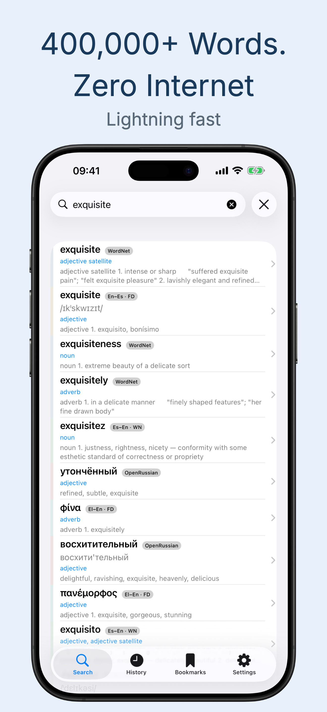
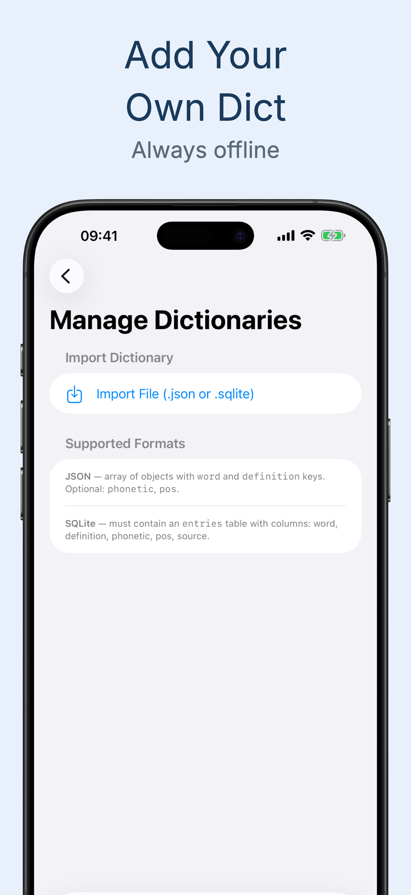
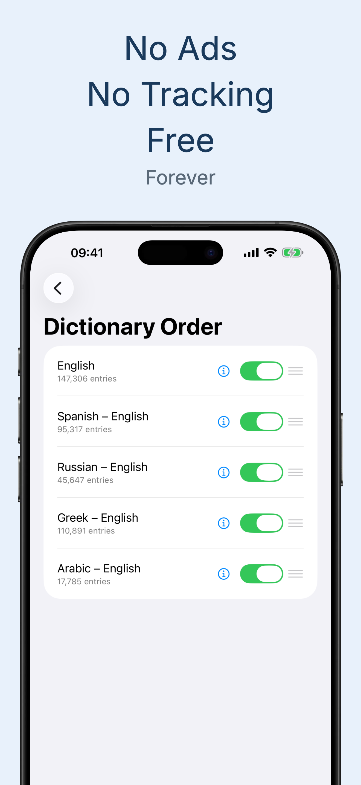
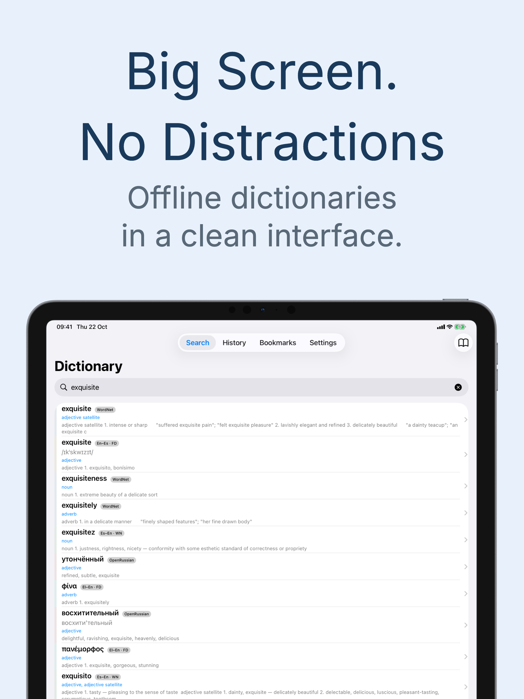

# LibreDict — Offline Dictionary

**400,000+ words at your fingertips. No Internet. No ads. No tracking. Just words.**

[](https://apps.apple.com/app/id6763217128)
[](https://developer.apple.com/ios/)
[](LICENSE)

---

## Features

- **Fully offline:** nine built-in dictionary sources, 400,000+ words, stored on the device.
- **Five language pairs:** English; English ⇄ Spanish; Russian – English; Arabic – English; Greek ⇄ English.
- **Interface in five languages:** English, Russian, Spanish, Arabic (right to left) and Greek.
- **Search as you type:** SQLite FTS5 results in milliseconds; Greek search ignores accents and final sigma, Arabic search ignores diacritics.
- **Dictionary order:** one row per language pair; switch pairs on or off, drag to reorder, tap (i) for each source's provider, version, size and license.
- **Quick first launch:** Search is ready in about a second; the dictionaries are prepared in the background.
- **Reading Mode:** keeps the screen awake while you read.
- **History and bookmarks**, pronunciation with text-to-speech, and import of your own `.json` / `.sqlite` dictionaries.
- **Private:** no accounts, no analytics, no third-party SDKs.

## Screenshots

| Search | Manage Dictionaries | Dictionary Order | iPad |
|:---:|:---:|:---:|:---:|
|  |  |  |  |

## Tech Stack

| Component | Technology |
|-----------|------------|
| UI | SwiftUI, iOS 17+ |
| Database | SQLite via [GRDB.swift](https://github.com/groue/GRDB.swift) |
| Search | FTS5 full-text search, `unicode61` tokenizer |
| Concurrency | Swift `actor` + `async/await` |
| Localization | String Catalog (`Localizable.xcstrings`) |
| Tests | XCTest unit tests, XCUITest UI tests |
| Dictionary data | Python build scripts (NLTK / Open Multilingual WordNet, FreeDict, OpenRussian) |

## Getting Started

### Prerequisites

- Xcode 26 (the app targets iOS 17.0 and later)
- [Git LFS](https://git-lfs.github.com): the bundled dictionary database is stored in LFS. The commands below install it with [Homebrew](https://brew.sh); any other Git LFS install works too

### Build & Run

```bash
brew install git-lfs && git lfs install
git clone https://github.com/kyukhin/dict-app.git
cd dict-app/DictApp
open DictApp.xcodeproj
```

Pick a simulator or a device and press **Run** (⌘R). Xcode resolves the GRDB package automatically. If you cloned without Git LFS, run `git lfs pull`: without it the app cannot open its dictionary database.

### Rebuild the dictionary data (optional)

`DictApp/DictApp/Resources/seed.sqlite` is prebuilt. To regenerate it from the sources, run from the repository root:

```bash
python3 -m venv .venv
source .venv/bin/activate
pip install nltk requests defusedxml
python Scripts/build_seed.py
```

`build_seed.py` calls the per-source builders in `Scripts/` (`build_freedict_eng_spa.py`, `build_spanish_wordnet.py`, `build_arabic_wordnet.py`, `build_greek.py`); `--skip-…` flags leave a source out, see its header for the options.

## Project Structure

```
dict-app/
├── DictApp/
│   ├── DictApp.xcodeproj
│   ├── DictApp/
│   │   ├── Models/          # Entries, app version, constants, UI languages
│   │   ├── Services/        # Database, settings, localization, speech, support
│   │   ├── ViewModels/      # Search, Definition, History, Bookmarks, Settings
│   │   ├── Views/           # SwiftUI screens
│   │   └── Resources/       # seed.sqlite, Schema.sql, Localizable.xcstrings
│   ├── DictAppTests/        # Unit tests
│   └── DictAppUITests/      # UI tests (page objects + test cases)
├── Scripts/                 # Dictionary data builders, build-info scripts
├── docs/specs/              # Feature specs (read these first)
├── metadata/                # App Store texts per language
├── Screenshots/             # App Store screenshots and mockup projects
└── CHANGELOG.md
```

## Dictionary Sources

| Dictionary | Direction | Entries | License |
|-----------|-----------|--------:|---------|
| [WordNet 3.0](https://wordnet.princeton.edu/) | English | 147,306 | WordNet 3.0 License (BSD-style), Princeton University |
| [OpenRussian](https://openrussian.org/) | Russian → English | 45,647 | CC BY-SA 4.0 |
| [FreeDict / WikDict](https://freedict.org/) | English → Spanish | 58,946 | CC BY-SA 3.0 |
| Spanish WordNet ([MCR](https://adimen.si.ehu.es/web/MCR) via [OMW](https://omwn.org/)) | Spanish → English | 36,371 | CC BY 3.0 |
| Arabic WordNet (via [OMW](https://omwn.org/)) | Arabic → English | 17,785 | CC BY-SA 3.0 |
| [Greek WordNet](https://github.com/okfngr/wordnet) (via OMW) | Greek → English | 17,882 | Apache 2.0 |
| [Greek WordNet](https://github.com/okfngr/wordnet) (via OMW) | English → Greek | 30,675 | Apache 2.0 |
| [FreeDict / WikDict](https://freedict.org/) | Greek → English | 41,589 | CC BY-SA 3.0 |
| [FreeDict](https://freedict.org/) (originally Freelang) | English → Greek | 20,745 | GNU GPL 2.0+ or CC BY-SA 3.0 (used under CC BY-SA 3.0) |

The full license texts ship with the app, in the (i) details in Dictionary Order; Settings → Credits lists the sources.

## Contributing

Development is spec-driven: start with [`docs/specs/README.md`](docs/specs/README.md) and the spec of the area you touch. User-facing changes go into [`CHANGELOG.md`](CHANGELOG.md).

## Releasing

Settings shows the version from `git describe`, so an App Store build must be archived from the release tag:

1. Bump the version and build in Xcode, cut the `CHANGELOG.md` section, merge to `master`.
2. Tag that commit and push the tag: `git tag -a vX.Y.Z -m "X.Y.Z version of the Dict app."` and `git push origin vX.Y.Z`.
3. Check out the tag and archive from it: `git fetch --tags && git checkout vX.Y.Z`, then Product → Archive. An archive whose `HEAD` is not tagged `v<version>` fails on purpose.
4. Upload, submit for review, then publish the GitHub release with the CHANGELOG section.

## License

The app's code is licensed under the MIT License, see [LICENSE](LICENSE). Dictionary data keeps its original licenses (table above).
